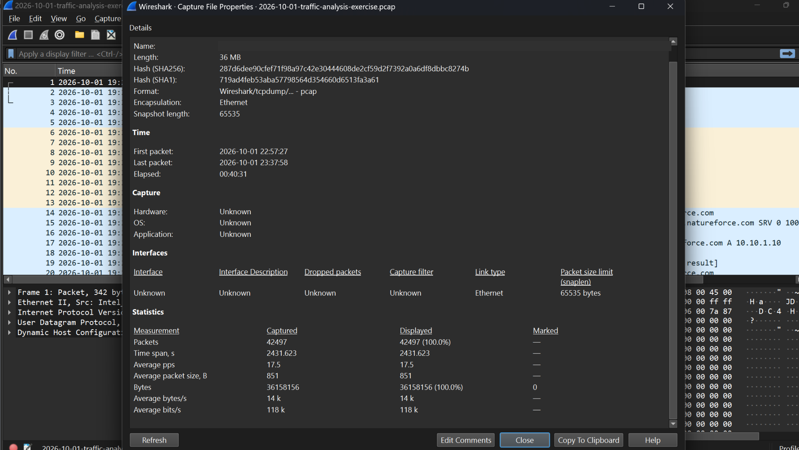
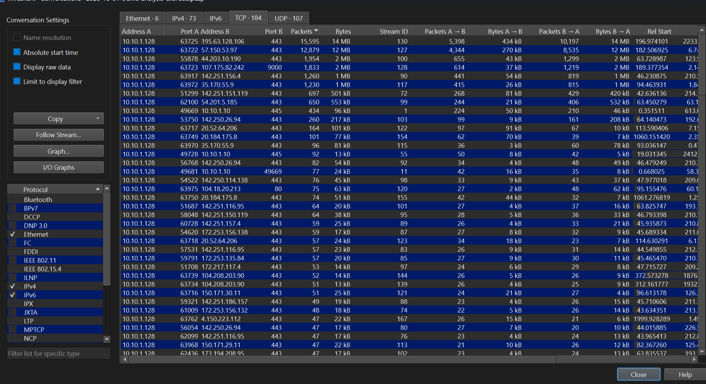
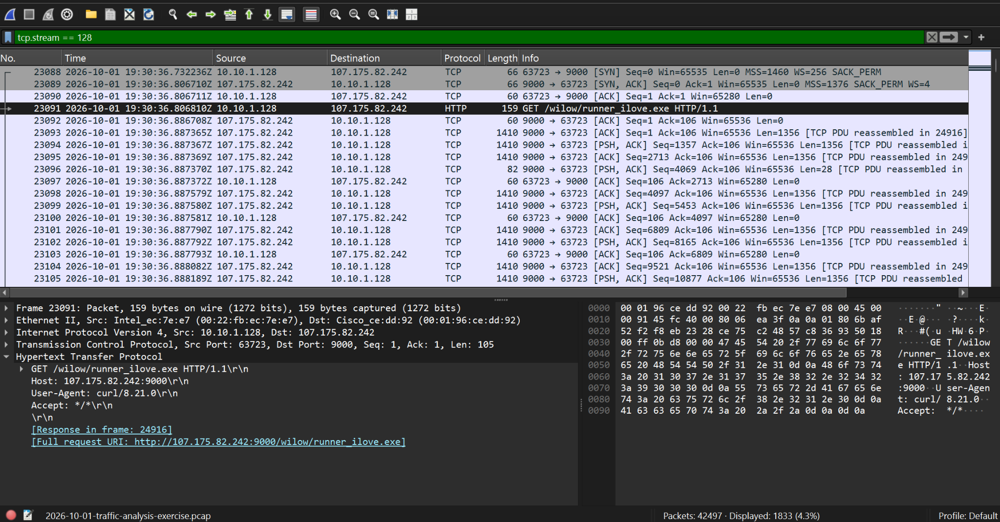
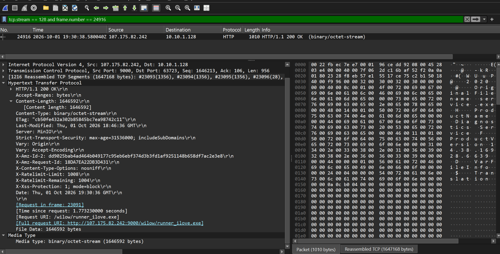
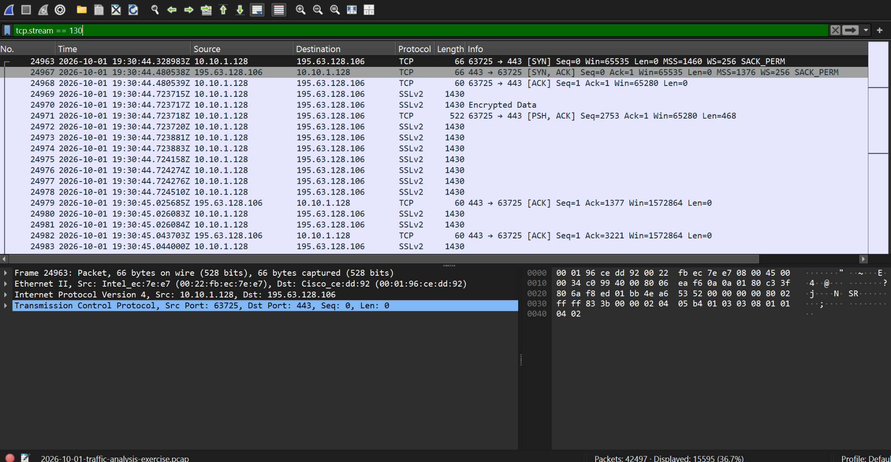
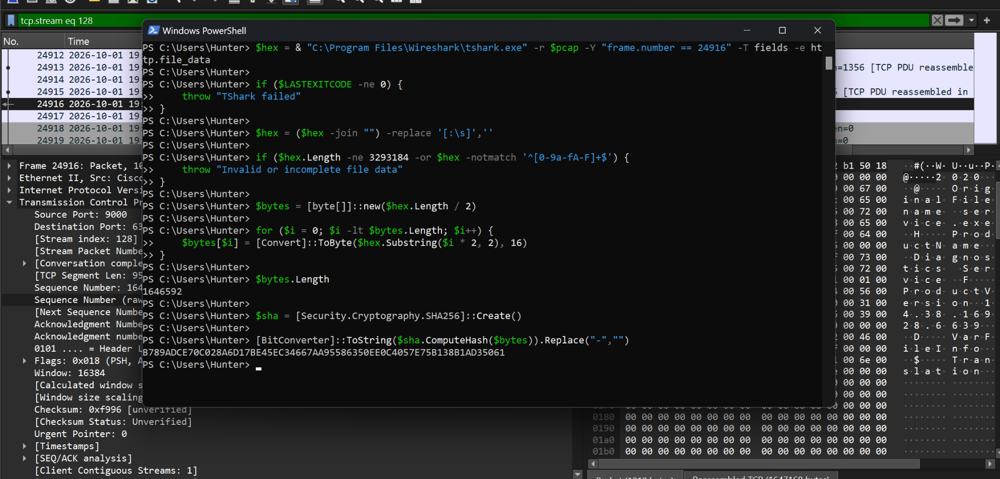
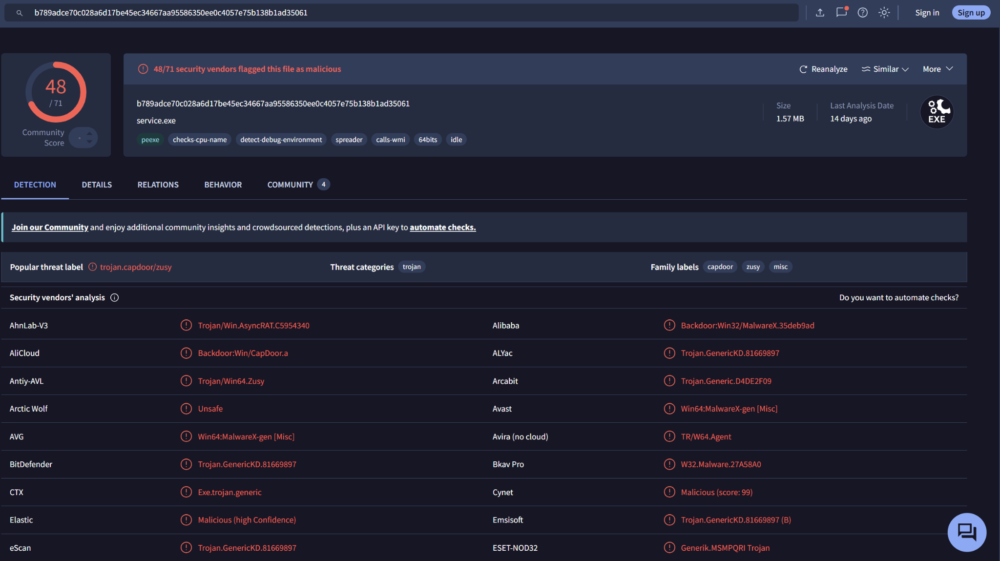
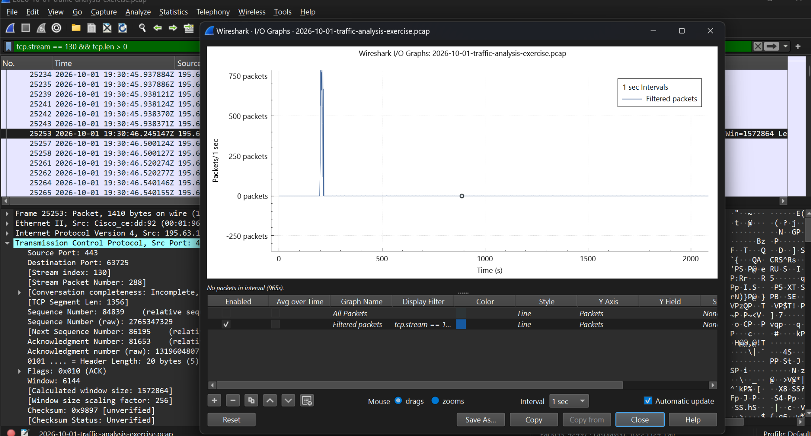

# Natureforce — RAT Network Investigation

   

## Project Overview

Hands-on SOC Tier 1 investigation of malicious executable delivery and suspected RAT C2 activity using Wireshark, TShark, PowerShell and VirusTotal. The Natureforce exercise (October 1, 2026) was investigated using PCAP evidence only. Malware delivery is confirmed with high confidence; execution and C2 remain unconfirmed.

## Investigation Environment

42,497 packets | Ethernet | 40m 31s | 10.10.1.0/24 | NATUREFORCE.COM

[Dataset and source](dataset/README.md) · [Full incident report](report/incident-investigation-report.md) · [Timeline](evidence/timeline.csv) · [IOCs](evidence/iocs.csv)

## Investigation Walkthrough

Eight key screenshots are shown below. [All 20 evidence screenshots](evidence/screenshots/) remain available for detailed review.

### Capture properties

Capture metadata: 42,497 packets, Ethernet, approximately 40 minutes 31 seconds.

### Protocol hierarchy

TCP dominates packet count; TLS accounts for 85.5% of bytes in the hierarchy.

### IPv4 endpoints

10.10.1.128 is the main internal endpoint.

### IPv4 conversations

Prioritized external peers by volume and duration.

### TCP conversations

Streams 127, 128 and 130 were selected for review.

### DNS infrastructure

DNS queries and responses identify 10.10.1.10 as the DNS server.

### TLS cloud connection

Stream 127 uses TLS 1.3; SNI is consistent with Azure Blob Storage.

### Executable request

Frame 23091: HTTP GET /wilow/runner_ilove.exe on TCP 9000.

### Executable response

Frame 24916: HTTP 200 OK and 1,646,592 bytes of reconstructed file data.

### PE indicators

MZ, DOS stub and PE section names support executable identification.

### Suspicious TCP connection

Stream 130 begins shortly after delivery; SSLv2 label does not establish the real protocol.

### NBNS hostname

Frame 33 registers DESKTOP-4VGYQX7.

### Computer account

Kerberos evidence associates the workstation computer account with NATUREFORCE.COM.

### SHA-256 extraction

TShark and PowerShell reconstruct and hash the HTTP body; byte count matches.

### Malware intelligence

48 of 71 vendors flagged the exact hash as malicious in the recorded lookup.

### Relations review

The reviewed Relations tab does not establish a link to the suspected C2 IP.

### I/O graph

The initial burst dominates the graph; low later activity is not necessarily zero.

### TCP Keep-Alive

After relative second 220, the displayed sample shows one-byte Keep-Alive probes about 20 seconds apart.

## Alert Validation and Behavioral Analysis

Alert 1 (107.175.82[.]242:9000) matches the executable transfer. Alert 2 reports 195.64.128[.]106:443, absent from the capture; stream 130 instead uses 195.63.128[.]106:443. The discrepancy is unresolved. Stream 130 began about 5.75 seconds after delivery and lasted about 37 minutes. Its initial burst was followed by low activity and observed TCP Keep-Alive approximately every 20 seconds, not proof of application polling or C2.

### Reported alerts

The exercise lists the executable delivery and suspected CNCmachineRMS C2 alerts.

### Alert IP discrepancy

The exact reported IP 195.64.128.106 returns zero packets.

## Key Findings

| Item | Result |
|---|---|
| Host | DESKTOP-4VGYQX7 / 10.10.1.128 |
| Malware delivery | runner_ilove.exe, stream 128, frames 23091/24916 |
| SHA-256 | `b789adce70c028a6d17be45ec34667aa95586350ee0c4057e75b138b1ad35061` |
| Threat intelligence | [VirusTotal](https://www.virustotal.com/gui/file/b789adce70c028a6d17be45ec34667aa95586350ee0c4057e75b138b1ad35061) — 48/71 at recorded lookup |
| Potential C2 | 195.63.128[.]106:443 — unconfirmed |
| Execution / human user | Not established |
| Severity / disposition | High (recommended) / Escalate to Tier 2 |

## Repository Contents

- [Full investigation report](report/incident-investigation-report.md)
- [Dataset documentation](dataset/README.md)
- [Findings](evidence/findings.md), [timeline](evidence/timeline.csv), [IOCs](evidence/iocs.csv)
- [Evidence screenshots](evidence/screenshots/)
- [Hash extraction script](scripts/extract_sha256.ps1)

## Limitations and Disclaimer

Educational PCAP investigation; no endpoint logs or live system access. Malware family, execution, persistence and C2 attribution remain unconfirmed. No executable or raw PCAP is redistributed. Do not contact observed infrastructure or execute samples.
